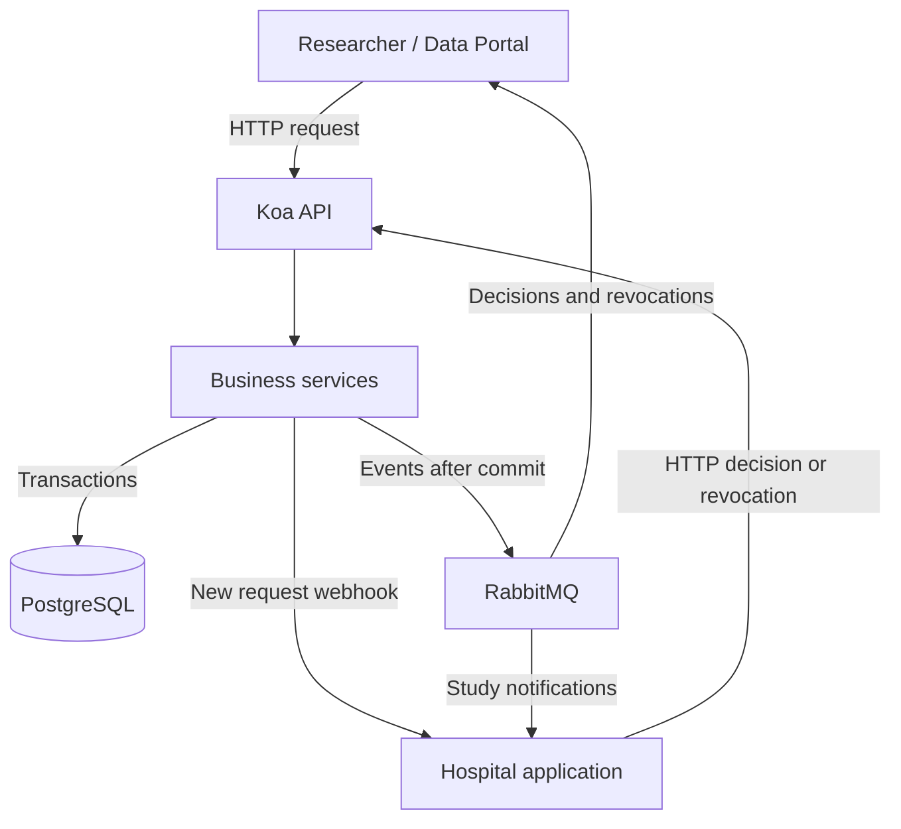
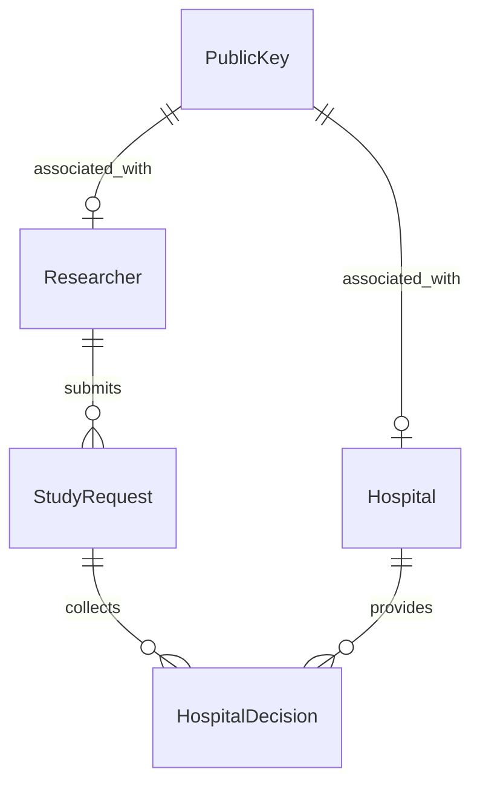
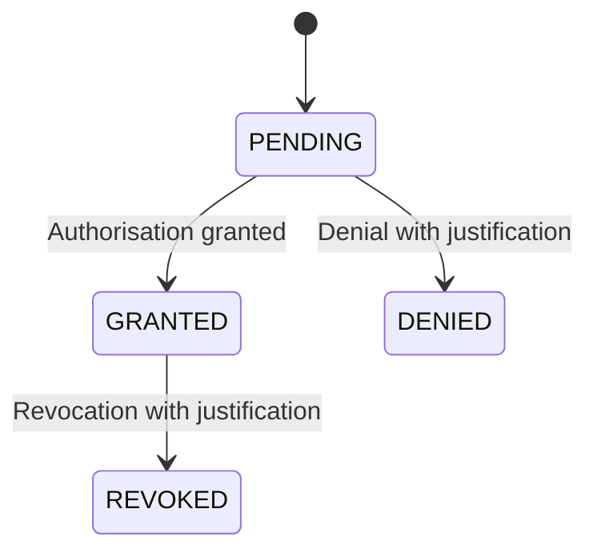
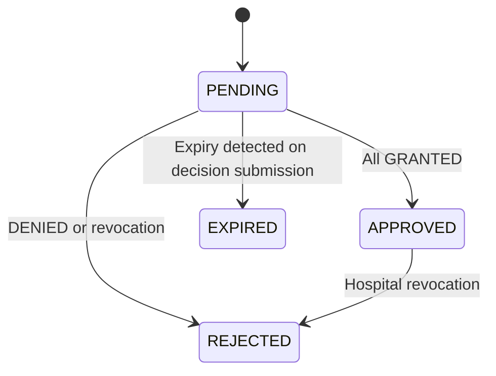
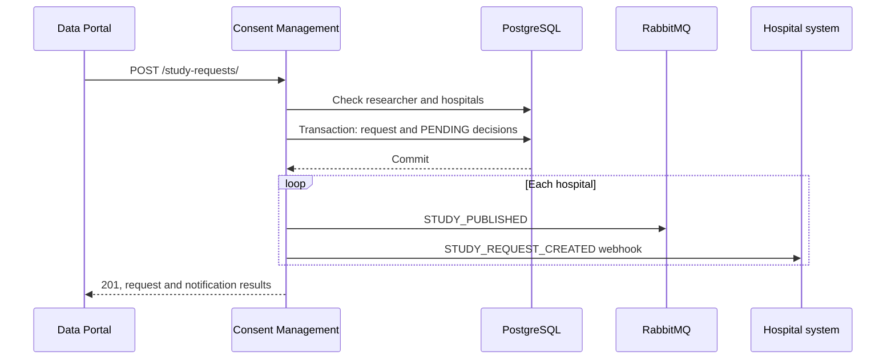

# TrustED — Consent Management

> Functional and technical guide to the component managing study requests and hospital authorisations.
>
> **Document version:** 1.1 · **Date:** 7 October 2026  
> **Source:** the `consent-managment/` source code in the supplied archive.  
> **Method:** static analysis of services, APIs, models, migrations and configuration. The application was not started while preparing this document.

## Contents

1. [Purpose and context](#1-purpose-and-context)
2. [Actors and responsibilities](#2-actors-and-responsibilities)
3. [Architecture](#3-architecture)
4. [Data model](#4-data-model)
5. [States and business rules](#5-states-and-business-rules)
6. [Operational workflows](#6-operational-workflows)
7. [REST API](#7-rest-api)
8. [Messaging and webhooks](#8-messaging-and-webhooks)
9. [Signatures and security](#9-signatures-and-security)
10. [Configuration and startup](#10-configuration-and-startup)
11. [Code structure](#11-code-structure)
12. [Implementation status and future work](#12-implementation-status-and-future-work)
13. [Demonstration scenario and verification](#13-demonstration-scenario-and-verification)

---

## 1. Purpose and context

The TrustED **Consent Management (CM)** component coordinates the process through which a researcher requests the use of data held by one or more hospitals. It records the request, identifies the organisations involved, collects their decisions and determines the overall outcome.

The core rule is straightforward: **a request is approved only when all participating hospitals have granted authorisation**. A denial prevents approval; a subsequent revocation makes the request no longer approved.

The CM stores operational state in PostgreSQL and communicates with external systems through HTTP APIs, RabbitMQ and webhooks. This allows the Data Portal and hospital applications to integrate the process without directly sharing the component’s database.

### What “consent” means in this implementation

The managed entity is a **hospital’s decision regarding a study request**. The data model does not contain patients or individual patient consents. The organisational authorisation described here should therefore not be confused with a complete system for collecting data subjects’ consent.

The component manages metadata, requests and decisions. The analysed code does not include a service that extracts or delivers clinical datasets, or an enforcement point that directly blocks data access. Systems providing data must integrate and enforce the workflow outcomes.

### Document scope

The archive also contains a `PPE/` directory, separate from `consent-managment/`. This guide covers the Consent Management component specified by the user. Its backend does not import blockchain services from PPE, and its Docker Compose configuration does not start a blockchain. Ethereum, smart contracts and zero-knowledge proofs are therefore not described as CM capabilities.

## 2. Actors and responsibilities

| Actor | Responsibility in the process |
| --- | --- |
| Researcher | Submits a study request and identifies the organisations holding the requested data. Must be registered and active. |
| Data Portal | A possible API client acting on behalf of the researcher and an application-level recipient of updates. The portal frontend is not implemented within the CM. |
| Hospital / Data Owner | Assesses requests involving its datasets, grants or denies authorisation, and may revoke a previously granted decision. |
| Consent Management | Validates references, stores requests and decisions, calculates aggregate status and attempts notification delivery. |
| Data-providing system | Must translate CM outcomes into effective access controls. This integration is outside the analysed code. |

Hospitals are identified externally by `organizationId`, supplied to the APIs as `owner_id`. Internal relationships and queue names use numerical database identifiers instead.

## 3. Architecture



Arrows towards external applications represent integration channels. The archive includes demonstration consumers, rather than complete hospital or researcher applications.

| Layer | Technology | Purpose |
| --- | --- | --- |
| Runtime | Node.js; Docker image `node:20-alpine` | Backend execution and HTTP client for webhooks. |
| API | Koa, `@koa/router`, `koa-bodyparser` | Routing, JSON parsing and HTTP responses. |
| Application logic | JavaScript services | Request creation, decisions, revocations and status aggregation. |
| Persistence | Sequelize and PostgreSQL `16-alpine` | Relational models, constraints, transactions and JSONB payloads. |
| Messaging | `amqplib`, RabbitMQ `4-management` | Topic exchange and recipient-specific queues. |
| Configuration | dotenv and Docker Compose | Database parameters, broker connection and ports. |

### Persistence and notifications

The database is the source of operational state. Changes are committed **before** external communication. If RabbitMQ or a webhook fails, an already stored request or decision is not rolled back; the problem is reported in the HTTP response.

This separation prevents notification failures from cancelling a valid decision, but may leave recipients unaware of the latest stored state. No persistent recovery mechanism for missing events is implemented.

## 4. Data model

The five main entities are `PublicKey`, `Researcher`, `Hospital`, `StudyRequest` and `HospitalDecision`.



The diagram describes logical relationships and foreign keys. The inverse Sequelize association `StudyRequest.hasMany(HospitalDecision)` is still commented out; the service retrieves decisions through explicit queries. The uniqueness of `publicKeyId` is defined separately for hospitals and researchers, rather than as a global exclusion across both tables.

### 4.1 PublicKey — `public_keys`

| Field | Meaning |
| --- | --- |
| `id` | Numerical primary key. |
| `publicKey` | Required, unique public key text. |
| `algorithm` | Description of the key algorithm. |
| `createdAt`, `updatedAt` | Creation and update timestamps. |

The model does not store private keys. Public keys provide the basis for signature verification, which still needs to be connected to the application workflows.

### 4.2 Researcher — `researchers`

Contains `id`, `externalId`, `name`, `email`, `role`, `organisation`, `status` and `publicKeyId`. Both `externalId` and `email` are unique; `role` is optional. Status can be `ACTIVE` or `INACTIVE`.

Each researcher is associated with a public key and can submit multiple requests. This model has `timestamps: false`.

### 4.3 Hospital — `hospitals`

Contains `id`, `name`, `country`, `organizationId`, `webhookUrl`, `status`, `publicKeyId` and timestamps. `organizationId` is unique. `country` is a two-character string; `webhookUrl` is optional and subject to URL validation in the model.

A hospital must be `ACTIVE` to be selected in a new request and to submit decisions or revocations.

### 4.4 StudyRequest — `study_requests`

| Field | Purpose |
| --- | --- |
| `id` | Internal numerical identifier used by the decision and revocation APIs. |
| `requestId` | Unique request identifier, read from `request_payload.request_id`. |
| `studyId` | External study identifier, read from `request_payload.study.study_id`. It is not unique in the schema. |
| `formType` | `DATA_REQUEST` or `DATA_ACCESS_APPLICATION`. |
| `title`, `language` | Study title and language. |
| `status` | Overall workflow status. |
| `researcherId` | Reference to the registered researcher. |
| `requestPayload` | Complete request content, stored as JSONB. |
| `signatureAlgorithm`, `signedPayloadHash`, `signatureValue` | Applicant signature metadata and value. |
| `signedAt` | Signature timestamp declared by the caller. |
| `submittedAt` | Reception timestamp assigned by the service. |
| `expiresAt` | Decision deadline, required by both the model and migration. |
| `resolvedAt` | Resolution timestamp; initially null. |
| `createdAt`, `updatedAt` | Sequelize timestamps. |

Earlier documentation describes `requestId` as generated by the CM, but **the current service takes it from the caller**. A duplicate value triggers a uniqueness error; it does not automatically return the previously created request.

Project documentation associates the two form types with requests for aggregated data (`DATA_REQUEST`) and applications involving individual-level data (`DATA_ACCESS_APPLICATION`). The service applies the same workflow to both.

### 4.5 HospitalDecision — `hospital_decisions`

| Field | Purpose |
| --- | --- |
| `id` | Decision identifier. |
| `studyRequestId`, `hospitalId` | Unique pair: one current decision per hospital and request. |
| `status` | `PENDING`, `GRANTED`, `DENIED` or `REVOKED`. |
| `signatureAlgorithm`, `signedPayloadHash`, `signatureValue` | Optional signature fields. |
| `rejectionReason` | Reason for denial or revocation. |
| `decidedAt` | Server timestamp of the latest decision; overwritten on revocation. |
| `revokedAt` | Server timestamp of revocation. |
| `createdAt`, `updatedAt` | Sequelize timestamps. |

Multiple datasets belonging to the same hospital produce **one hospital decision**. The CM deduplicates `owner_id` values while preserving the dataset list in the notification.

The table represents current state, rather than an immutable history: revocation updates the same row and also replaces the signature and reason fields.

## 5. States and business rules

### 5.1 Individual decision status



No endpoint changes `DENIED` or `REVOKED` back to `GRANTED`. An initial decision is accepted only while both the request and the hospital decision are `PENDING`.

### 5.2 Overall request status

| Condition | Request status |
| --- | --- |
| Some decisions are still pending, with no denial or revocation | `PENDING` |
| All hospitals have decided `GRANTED` | `APPROVED` |
| At least one hospital decides `DENIED` | `REJECTED` |
| A hospital revokes a `GRANTED` decision | `REJECTED` |
| The request is still `PENDING`, the deadline has passed and a decision submission is attempted | `EXPIRED` |



**`REVOKED` is a hospital decision status, not a `StudyRequest` status.** Following a denial, ordinary decision submissions from other hospitals still awaiting a response are no longer accepted.

Revocation requires a local `GRANTED` decision and a request that is not `EXPIRED`. The code also allows it while the study is `PENDING`, or already `REJECTED` because of another hospital.

### 5.3 Actual expiry behaviour

Creation reads `study.expires_at` first, then `request_payload.expires_at` if the former is absent. A past date is rejected. The service does not assign a default duration: when the date is missing, it attempts to store `null`, which conflicts with the required field constraint.

There is no periodic job that automatically updates all expired requests. The transition to `EXPIRED` occurs when a decision submission is attempted for a pending request after its deadline. Without further calls, a request may therefore remain stored as `PENDING` beyond that deadline.

The revocation endpoint checks the `EXPIRED` status but does not independently compare `expiresAt` against the current time. Expiry also does not automatically terminate a study that is already `APPROVED`.

## 6. Operational workflows

### 6.1 Submitting a request

1. The caller supplies the researcher, study payload and signature fields.
2. The service checks that the researcher exists and is active.
3. It extracts and deduplicates `owner_id` values and checks that all correspond to active hospitals.
4. It checks that the supplied deadline has not already passed.
5. In one transaction, it creates a `PENDING` request and a `PENDING` decision for each hospital.
6. After committing, it attempts RabbitMQ publication and then webhook delivery for each hospital.
7. It returns the stored request and results for both notification channels.



### 6.2 Hospital decision

The service accepts `GRANTED` or `DENIED` and normalises the value to uppercase. It checks the active hospital and the request. If it detects a pending request past its deadline, it marks it `EXPIRED` and stops the operation.

For a valid request, it opens a transaction, locks the study and decision rows with `LOCK.UPDATE`, checks the hospital assignment and updates the decision. A justification is required for `DENIED`. It then reads all decisions and recalculates overall status, setting `resolvedAt` when the request is resolved.

After commit, it publishes `STUDY_DECISION_RECORDED` towards the researcher’s queue. An external consumer can use `studyStatus` to update the Data Portal.

### 6.3 Revocation

A hospital supplies a justification to revoke its `GRANTED` decision. In the same transaction, the CM changes the decision to `REVOKED`, sets `revokedAt` and changes the study to `REJECTED`. After commit, it publishes `STUDY_CONSENT_REVOKED`.

Stopping data access that is already active depends on the external system’s response: this call changes state and attempts notification, but does not close sessions or revoke credentials in other services.

## 7. REST API

Default local base URL: `http://localhost:3000`.

| Method | Path | Successful outcome |
| --- | --- | --- |
| `POST` | `/study-requests/` | `201` — creates the request and initial decisions. |
| `POST` | `/study-requests/:studyRequestId/decisions` | `200` — records a decision. |
| `POST` | `/study-requests/:studyRequestId/decisions/revoke` | `200` — revokes a granted decision. |

The path parameter `studyRequestId` is the **integer `StudyRequest.id`**, not `requestId` or `studyId`. GET routes, actor registration APIs and an access-verification endpoint are not implemented.

### 7.1 Create a request

The following illustrates the request structure. Actor identifiers and dates must be adapted to the target environment. Hashes and signatures are demonstration placeholders, not valid cryptographic proofs.

```json
{
  "researcher_id": 1,
  "request_payload": {
    "request_id": "req_demo_001",
    "form_type": "DATA_ACCESS_APPLICATION",
    "study": {
      "study_id": "study_demo_001",
      "title": "Multicentre study of respiratory data",
      "language": "en",
      "expires_at": "2027-12-31T23:59:59Z"
    },
    "requested_data_owners": [
      {
        "owner_id": "123-ABC",
        "country_code": "IT",
        "dataset_id": "DATASET-A"
      },
      {
        "owner_id": "456-ABC",
        "country_code": "FR",
        "dataset_id": "DATASET-B"
      }
    ],
    "purpose_of_use": {
      "purpose": "scientific_research",
      "purpose_justification": "Multicentre analysis of respiratory diseases"
    }
  },
  "applicant_signature": {
    "signature_algorithm": "RSA-SHA256",
    "signed_payload_hash": "DEMONSTRATION_HASH",
    "signature_value": "DEMONSTRATION_SIGNATURE",
    "signed_at": "2026-10-07T12:00:00Z"
  }
}
```

The model requires the four applicant signature fields, along with the mandatory request data. Storing these values does not currently involve cryptographic verification.

The response contains:

| Property | Content |
| --- | --- |
| `message` | Confirmation message. |
| `studyRequest` | Created record, including the `id` to use in subsequent calls. |
| `rabbitMqNotifications` | `delivered` count and `errors` list. |
| `webhookNotifications` | `delivered` count and `errors` list. |

An HTTP `201` may still include notification errors. For RabbitMQ, `delivered` counts attempts that did not throw an exception; it does not confirm that hospitals consumed the messages.

### 7.2 Grant or deny authorisation

`POST /study-requests/1/decisions`

```json
{
  "owner_id": "123-ABC",
  "decision": "GRANTED",
  "signature": {
    "algorithm": "RSA-SHA256",
    "signed_payload_hash": "DEMONSTRATION_DECISION_HASH",
    "signature_value": "DEMONSTRATION_DECISION_SIGNATURE"
  }
}
```

To deny:

```json
{
  "owner_id": "456-ABC",
  "decision": "DENIED",
  "justification": "The requested conditions do not permit sharing this dataset."
}
```

The decision `signature` object is currently optional. Note the different algorithm field names: `applicant_signature.signature_algorithm` for creation, and `signature.algorithm` for decisions and revocations.

The response exposes `hospitalDecision`, `studyStatus`, `notificationPublished`, `publicationError` and a message. `notificationPublished: true` does not certify that the recipient processed the event.

### 7.3 Revoke

`POST /study-requests/1/decisions/revoke`

```json
{
  "owner_id": "123-ABC",
  "justification": "Authorisation withdrawn following a change in the conditions of use."
}
```

There is no need to send `decision: REVOKED`: the endpoint determines the operation. An optional `signature` object has the same structure as for an ordinary decision.

### 7.4 Errors

Errors return JSON in the form `{"error": "description"}`.

| Situation | Current behaviour |
| --- | --- |
| Creation error, including database constraints | `400`. |
| Missing request, missing/inactive hospital or hospital not assigned, during decisions/revocations | `404`. |
| Decision already submitted, request already resolved or expired | Generally `409`. |
| Invalid decision value or missing justification | `400`. |
| Attempt to revoke a decision that is not `GRANTED` | `400` in the current code. |

The controller classifies errors by message text. Its check for `Only an APPROVED decision` does not match the actual message `Only a GRANTED decision...`, so the last case is not classified as a conflict. A future revision should use typed errors.

## 8. Messaging and webhooks

### 8.1 RabbitMQ

The default exchange is `study.events`, a durable `topic` exchange. Its name can be configured through `RABBITMQ_STUDY_EXCHANGE`. Queues are durable and of type `quorum`; publishers mark messages as persistent and JSON.

| Recipient | Queue | Routing key / binding |
| --- | --- | --- |
| Hospital | `hospital.{hospitalId}.notifications` | `study.published.hospital.{hospitalId}` |
| Researcher | `researcher.{researcherId}.notifications` | Binding: `study.decision.*.researcher.{researcherId}` |
| Decision sent to researcher | Same researcher queue | `study.decision.{decision}.researcher.{researcherId}` |

The values of `{decision}` are `GRANTED`, `DENIED` and `REVOKED`. A single Docker broker does not by itself provide high availability, even when queues are declared as quorum queues.

| Event | Main information |
| --- | --- |
| `STUDY_PUBLISHED` | Internal IDs, `studyId`, hospital/owner, title, that hospital’s datasets, publication time and deadline. |
| `STUDY_DECISION_RECORDED` | Study, researcher, hospital, decision, optional justification, `studyStatus`, `decidedAt`. |
| `STUDY_CONSENT_REVOKED` | Identifiers, `REVOKED` decision, justification, `studyStatus: REJECTED`, `revokedAt`. |

New-request events do not contain the complete `requestPayload`. Since there is no GET detail route, hospital retrieval of the full application requires additional integration.

The included consumers use manual acknowledgement: they call `ack` after processing and `nack(msg, false, false)` on error. No dead-letter queue is configured. The hospital consumer can invoke a callback; the researcher consumer logs the message. **`server.js` does not automatically start these consumers.**

Publishers use an ordinary channel without publisher confirms. The boolean returned by `channel.publish` concerns buffering and is not a delivery confirmation. There is no transactional outbox, persistent retry mechanism or application-level event deduplication. After a connection closes, a subsequent call can reopen it; there is no complete reconnection loop that automatically reactivates consumers.

### 8.2 HTTP webhooks

When a request is created, the CM sends a `POST` to each hospital’s `webhookUrl`, in addition to the RabbitMQ notification. The body has this structure:

```json
{
  "eventId": "UUID-generated-by-the-service",
  "eventType": "STUDY_REQUEST_CREATED",
  "occurredAt": "2026-10-07T12:00:00Z",
  "data": {
    "studyRequestId": 1,
    "requestId": "req_demo_001",
    "studyId": "study_demo_001",
    "formType": "DATA_ACCESS_APPLICATION",
    "title": "Multicentre study of respiratory data",
    "language": "en",
    "expiresAt": "2027-12-31T23:59:59Z",
    "submittedAt": "2026-10-07T12:00:00Z"
  }
}
```

Headers include `Content-Type: application/json`, `X-Webhook-Event` and `X-Webhook-Event-Id`. The timeout is 5 seconds. An unsuccessful response or missing `webhookUrl` is reported as a notification error without rolling back creation.

The main service attempts notifications sequentially for each hospital. A helper for parallel delivery also exists, but is not used in that workflow. Webhook signatures, sender authentication and automatic retries are not implemented. Decisions and revocations are notified through RabbitMQ, rather than through this webhook.

## 9. Signatures and security

The project contains the data structures and utilities needed to begin integrating digital signatures:

| File | Existing functionality |
| --- | --- |
| `src/utils/hash.js` | SHA-256 hashing; uses `JSON.stringify` for objects. |
| `src/utils/signature.js` | Signing and verification using `crypto.sign` / `crypto.verify`, SHA-256 and Base64 signatures. |
| `src/utils/keyPair.js` | RSA 2048-bit key generation and key parsing checks. |

**The request, decision and revocation services do not call these utilities to verify incoming signatures.** The `signatureAlgorithm` field is stored but does not automatically select and enforce a verification algorithm. The declared hash is not compared with the payload, and signature freshness or reuse is not checked.

The analysed Koa middleware does not implement authentication or authorisation. `researcher_id` and `owner_id` are caller-supplied references, not authenticated identities. Consequently, the component does not yet verify that the party submitting a decision actually represents the specified hospital.

Completing this functionality requires an exact signed-data format, deterministic serialisation, resolution of the registered public key and verification before persistence. A decision signature should bind at least the request, organisation and decision, together with information to prevent reuse. `JSON.stringify` alone does not define an interoperable canonicalisation scheme across clients.

Private keys must remain in the signing systems. Key rotation and retention of the exact key/version used for each signature are not implemented. Endpoint protection, notification authentication and inter-organisation authorisation rules also need to be integrated.

## 10. Configuration and startup

This section describes a procedure derived from the project files, rather than a deployment verified during document preparation.

### 10.1 Services and ports

| Compose service | Container | Host-facing port |
| --- | --- | --- |
| `backend` | `TRUSTED-backend` | `3000` |
| `postgres` | `TRUSTED-DB` | `${POSTGRES_PORT}` mapped to `5432` |
| `rabbitmq` | `TRUSTED-rabbitmq` | `5672` AMQP and `15672` management |

PostgreSQL and RabbitMQ use persistent named volumes. The backend waits for their health checks but does not automatically run migrations or seeds.

### 10.2 Variables

| Variable | Use |
| --- | --- |
| `POSTGRES_DB`, `POSTGRES_USER`, `POSTGRES_PASSWORD` | Application database and credentials. |
| `POSTGRES_PORT` | Host-published port; the Docker backend uses `5432` internally. |
| `DB_HOST` | `localhost` for local execution, `postgres` for the Compose backend. |
| `RABBITMQ_USER`, `RABBITMQ_PASS` | Broker credentials configured by Compose. |
| `RABBITMQ_URL` | AMQP URL read by the application. |
| `RABBITMQ_STUDY_EXCHANGE` | Optional exchange name; defaults to `study.events`. |
| `PORT` | Node server port; defaults to `3000`. |

The `.env.example` file contains only PostgreSQL variables. Compose uses fixed AMQP credentials in `backend.environment.RABBITMQ_URL`, while the broker reads its username and password from variables. These values must be aligned before startup.

A recommended configuration change is to replace that Compose field with:

```yaml
RABBITMQ_URL: ${RABBITMQ_URL}
```

Then define a URL in `.env` using hostname `rabbitmq`, port `5672` and credentials matching the broker. When running Node on the host, the URL must instead reach the broker through `localhost`. Special characters in credentials must be correctly URL-encoded.

### 10.3 Database preparation

From the `consent-managment/` directory:

```bash
cp .env.example .env
# Complete .env and align the RabbitMQ configuration before continuing.
docker compose up -d postgres rabbitmq
```

With Node.js and npm installed on the host, install development dependencies as well and run migrations:

```bash
cd src
npm ci
npm run db:migrate
```

The PostgreSQL container creates the configured database when it initialises the volume. Sequelize configuration reads `.env` from the project root and contains only a `development` section.

The Dockerfile uses `npm install --omit=dev`, so `sequelize-cli`, a development dependency, is not included in the runtime image. Run migrations using the local procedure above or prepare a dedicated migration image/job.

### 10.4 Initial data and backend startup

Hospitals, researchers and keys must be registered before making API calls; no onboarding APIs are exposed. Demonstration seeders are available and can be run from `src/` using `npm run db:seed` **after checking their fixtures and references**.

The key seeder reads PEM files from `src/test/fixtures/keys/`. Do not automatically use `utils/keyPair.js` to prepare them: its top-level code generates a new pair for each file, so the resulting private and public files do not belong to the same pair. It also uses relative paths and append mode. A cryptographic demonstration requires generating each pair once and saving the two corresponding values.

After preparing the schema and initial data, run from the project root:

```bash
docker compose up -d --build backend
docker compose ps
docker compose logs -f backend
```

The backend exposes its APIs at `http://localhost:3000`; RabbitMQ management is at `http://localhost:15672`. No HTTP health-check endpoint is implemented: a `404` response to `GET /` does not, by itself, indicate a failure.

To stop services while keeping volumes:

```bash
docker compose down
```

The `npm run db:reset` script drops and recreates the database. It is intended for a disposable demonstration environment.

## 11. Code structure

The paths below are relative to `consent-managment/`.

| Path | Responsibility |
| --- | --- |
| `docker-compose.yml` | Backend, PostgreSQL, RabbitMQ, volumes and health checks. |
| `src/Dockerfile` | Node image build. |
| `src/server.js` | Starts the HTTP listener. |
| `src/app.js` | Body parser and route registration. |
| `src/routes/` | The component’s three public endpoints. |
| `src/controllers/` | Translation between HTTP input, services and responses. |
| `src/services/studyRequest.service.js` | Transactional creation and hospital notifications. |
| `src/services/studyDecision.service.js` | Decisions, revocations, expiry and aggregate status. |
| `src/services/webhook.service.js` | New-request webhook delivery. |
| `src/models/` | Entities, application constraints and Sequelize associations. |
| `src/migrations/` | Database tables, enums, indexes and constraints. |
| `src/seeders/` | Demonstration data. |
| `src/messagging/` | RabbitMQ connection, queues, routing, publishers and consumers. |
| `src/utils/` | Cryptographic utilities not yet integrated into the services. |
| `src/services/test/`, `src/messagging/test/` | Service and messaging test scripts. |
| `docs/` | Existing documentation, partially out of sync with the code. |

The names `messagging` and `queques.js` reproduce the actual project names.

## 12. Implementation status and future work

| Capability | Observed status |
| --- | --- |
| Requests involving multiple hospitals | Implemented with owner deduplication. |
| Decisions and unanimous approval | Implemented. |
| Justified denial and revocation | Implemented; revocation makes the study `REJECTED`. |
| Atomicity of main application changes | Transactions and locks for decisions/revocations. |
| RabbitMQ notifications | Implemented without publisher confirms or persistent recovery. |
| New-request webhooks | Implemented with timeout and error reporting. |
| Expiry | Checked on decision submission; no periodic job. |
| Digital signatures | Fields and utilities exist; verification is not integrated. |
| API authentication and authorisation | Not present in the analysed middleware. |
| Request and decision retrieval through APIs | No GET routes. |
| Idempotency | Unique constraints exist, but no idempotent request protocol. |
| Complete decision history | Not present; the same row is updated. |
| Data-access enforcement | Requires integration with external systems. |
| Blockchain and ZKPs | Not integrated into the analysed CM backend. |

### Proposed technical priorities

1. **Complete the integration contract:** add request, status and decision retrieval; define identifiers; and provide hospitals with full study details.
2. **Connect identities and signatures:** authenticate callers, authorise them for their organisation and verify payloads and signatures before changing state.
3. **Make notifications reliable:** introduce a transactional outbox, broker confirms, retries, event identifiers and consumer deduplication.
4. **Complete expiry handling:** add periodic processing and coordinate time checks with transactions. The current update to `EXPIRED` occurs outside the decision transaction’s lock, creating a possible race between concurrent operations.
5. **Preserve history:** record grants and revocations as separate events, retaining the signatures and keys used.
6. **Align supporting materials and startup:** update tests and documentation, and provide consistent fixtures, broker configuration and repeatable migrations.

These are proposals derived from code analysis, not already implemented capabilities or official TrustED roadmap commitments.

## 13. Demonstration scenario and verification

### Scenario: one study, three hospitals

A researcher submits a request involving hospitals A, B and C. The CM creates one `StudyRequest` and three `HospitalDecision` records.

| Step | Hospital A | Hospital B | Hospital C | Study status |
| --- | --- | --- | --- | --- |
| Creation | `PENDING` | `PENDING` | `PENDING` | `PENDING` |
| First grant | `GRANTED` | `PENDING` | `PENDING` | `PENDING` |
| Second grant | `GRANTED` | `GRANTED` | `PENDING` | `PENDING` |
| Third grant | `GRANTED` | `GRANTED` | `GRANTED` | `APPROVED` |
| B revokes | `GRANTED` | `REVOKED` | `GRANTED` | `REJECTED` |

If B instead submits `DENIED` during review, the study immediately becomes `REJECTED`. There is no need to wait for C, and its subsequent ordinary decision is rejected because the request is already resolved.

### Cases to verify in an end-to-end demonstration

| Case | Expected result according to the code |
| --- | --- |
| Same owner repeated for multiple datasets | One decision for that hospital. |
| Inactive hospital or researcher | Relevant operation rejected. |
| All decisions `GRANTED` | Study `APPROVED`, with `resolvedAt`. |
| One `DENIED` with justification | Study `REJECTED`. |
| Denial without justification | Error; no decision saved. |
| Revocation of a `GRANTED` decision | Decision `REVOKED`, study `REJECTED`, revocation event publication attempted. |
| Pending decision submitted after the deadline | Study `EXPIRED`; decision rejected. |
| Broker or webhook unavailable | State saved; notification error included in the response. |
| Second decision from the same hospital | Rejected without overwriting the first decision. |

The included scripts are not yet a test suite aligned with the current version. In particular, `src/services/test/test-study-service-flow.js` submits and expects `APPROVED` as a hospital decision, whereas the service accepts `GRANTED`. It also reads outdated publication-result fields. These scripts must be updated before being used as evidence of correctness.

---

## Internal references

Descriptions of current behaviour are primarily based on:

- `src/services/studyRequest.service.js` — creation, hospital selection, payload and notifications.
- `src/services/studyDecision.service.js` — decision rules, revocation, expiry and aggregation.
- `src/routes/` and `src/controllers/` — HTTP contract and error classification.
- `src/models/` and `src/migrations/` — schema, nullability and constraints.
- `src/messagging/` and `src/services/webhook.service.js` — events and delivery behaviour.
- `src/app.js`, `src/server.js`, `src/package.json`, `src/Dockerfile` and `docker-compose.yml` — runtime and startup.

Where comments or earlier documents describe different behaviour, this guide gives precedence to the executable code.
